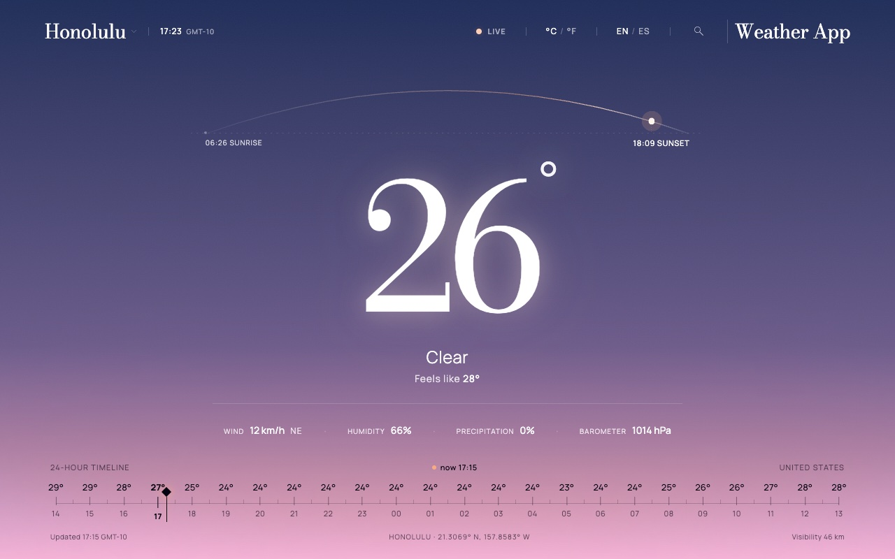
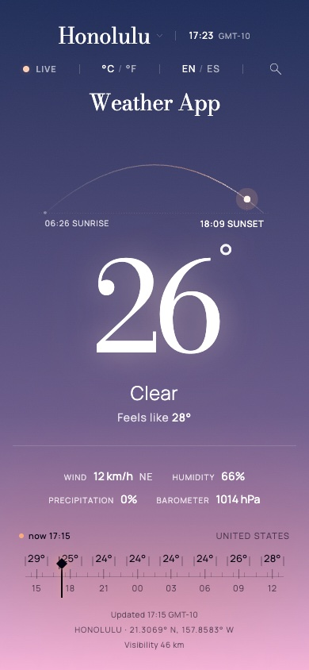

# Weather App

The sky of any city, right now. A bilingual weather app where the whole screen is the city's live sky, computed from real data, and a 24-hour ruler lets you travel through the day.

**Live demo:** coming soon.

<p>
  
  
</p>

## What it does

- **The screen is the sky.** The background gradient follows the real sun altitude, the cloud cover and the rain of the selected city and time. It changes continuously as you move through the day, and drops fall only when the forecast says rain.
- **Text that always reads.** Every zone picks a light or dark ink from the sky color right behind it, so text keeps WCAG AA contrast (4.5:1) on any sky.
- **A 24-hour ruler.** Drag it, use the mouse wheel or the arrow keys. The sky, the big number, the metrics, the sun on its arc and the LIVE / FORECAST / EARLIER status all follow.
- **Search any city.** Suggestions as you type, keyboard navigation, "Use my location", and shareable URLs such as `/en/buenos-aires-3435910`.
- **English and Spanish,** with °C / °F. Both choices are remembered in cookies, so the page arrives right with no flash.

## Stack

Next.js 16 (App Router) · React 19 · TypeScript (strict) · Tailwind CSS 4 · Motion · Zod · suncalc · culori · Vitest + Testing Library · Playwright · GitHub Actions. Data from the Open-Meteo forecast and geocoding APIs.

## Architecture

```
Server (Next)                                      Browser
─────────────                                      ───────
app/[lang]/[place]/page.tsx  (Server Component)
 ├─ resolves the place (id → name and coordinates)
 ├─ getForecast(place)  → Open-Meteo
 │    ├─ validates with Zod
 │    ├─ normalizes into our Forecast type
 │    └─ caches for 10 min
 └─ renders <WeatherApp forecast unit dict />  ────►  <WeatherApp> (Client Component)
                                                       state: selected time
                                                       derived: hour point, sun,
                                                       sky palette, ink colors
app/api/search/route.ts  ◄─────────────────────────  <SearchOverlay> asks for suggestions
 └─ Open-Meteo Geocoding (validated, cached 1 day)
proxy.ts: "/" → "/en" or "/es" (cookie, then Accept-Language)
```

Data is fetched on the server; interaction lives on the client. The only piece of state is the time selected on the ruler. Everything else is derived from the data plus that time by pure, unit-tested functions in `src/lib`.

## Key decisions

- **One state, everything derived.** `deriveScene(forecast, selected)` returns the hour to show, the status, the sun and the sky theme. It uses the forecast's own "now" rather than `Date.now()`, so the server and the browser derive the same scene.
- **Sky colors from the sun.** Five palettes, from night to day, are blended in OKLCH by the exact sun altitude; clouds pull them toward gray and rain darkens them. The values are written as CSS variables registered with `@property`, so the browser animates them (600 ms, instant under reduced motion).
- **Contrast beats pixel fidelity.** Where the Figma design fades text or uses peach on a peach sky, the app keeps 4.5:1 instead (for example, near-black ink on the golden-hour horizon).
- **URLs with an id.** `/{lang}/{slug}-{id}`: "Buenos Aires" exists in Argentina and in Nicaragua, so the Open-Meteo id picks the city and the slug is only for reading. A non-canonical slug answers with a 308 to the canonical one (`/es/london-2643743` → `/es/londres-2643743`).
- **Validate at the boundary.** Every Open-Meteo response goes through Zod before use. A broken answer becomes a handled error page, never `undefined` on screen. Data modules import `server-only`.
- **A native slider under the ruler.** An invisible `<input type="range">` sits under the drawing, so dragging, keyboard and screen readers work natively. `aria-valuetext` reads like "17:15, 26 degrees".
- **Search that never shows stale results.** It waits 300 ms after typing, aborts the previous request with an `AbortController`, and only accepts the answer for the text on screen. A test reproduces responses arriving out of order.
- **Rain that doesn't look like stripes.** 70 CSS drops, each with its own position, length, speed and start drawn from a fixed-seed random, so they never fall in sync. Its strength follows the millimeters of rain.

The full reasoning lives in the [technical spec](docs/spec.md) and the [implementation plan](docs/plan.md). Design values extracted from Figma are in [`docs/design/figma-tokens.md`](docs/design/figma-tokens.md).

## Run it

Requires Node 24 (see `.nvmrc`).

```bash
npm ci
npm run dev          # http://localhost:3000
```

## Test it

```bash
npm test                         # unit and component tests (Vitest)
npx playwright install chromium  # once
npm run test:e2e                 # end-to-end tests (Playwright, real Open-Meteo data)
npm run lint && npm run typecheck && npm run format:check
```

CI runs the same checks, plus the build and the end-to-end tests, on every pull request.

## Contributing

One branch per change, [Conventional Commits](https://www.conventionalcommits.org/), and a pull request with what / why / how to test. CI must pass before merging.

## Previous version

This is a from-scratch rebuild of my [2022 bootcamp weather app](https://github.com/paulakunning/weather-app) (Create React App, Chakra UI, OpenWeather).

---

<sub>Weather and geocoding data by [Open-Meteo](https://open-meteo.com/) (CC BY 4.0). Fonts: Bodoni Moda and Manrope (Google Fonts). Favicon based on "Forecast Weather Sun Cloud" from [SVG Repo](https://www.svgrepo.com/svg/384329/forecast-weather-sun-cloud).</sub>
